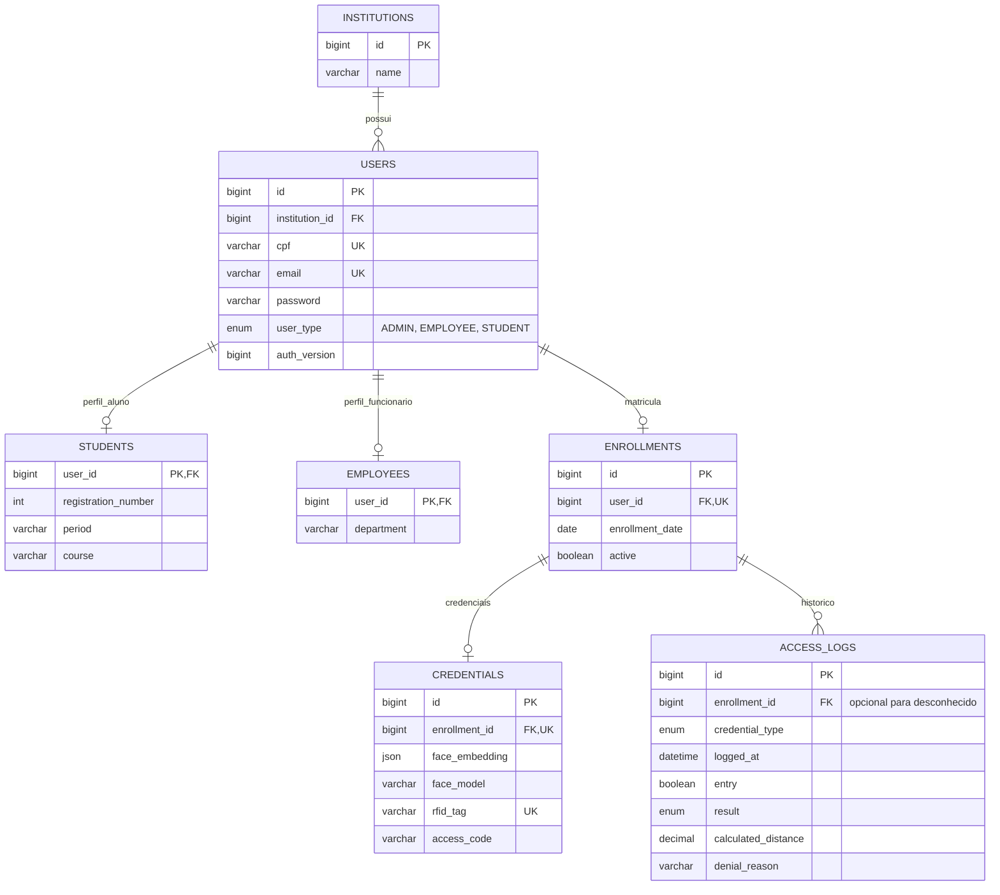

# Modelo de dados executável

Este documento registra o modelo efetivamente implementado pelas entidades JPA e pelo schema MySQL. Ele deve permanecer sincronizado com o MER/DER acadêmico.

## Regras estruturais

- Uma pessoa pertence obrigatoriamente a uma instituição.
- `Student` e `Employee` compartilham a chave primária de `User` por `@MapsId`.
- `ADMIN` é um tipo de usuário com perfil de funcionário e departamento.
- Uma pessoa possui no máximo uma matrícula no protótipo atual.
- Uma matrícula possui no máximo um agregado de credenciais.
- Uma tentativa desconhecida mantém `enrollment_id` nulo, mas ainda registra modalidade, máquina, sentido e negativa.
- Senhas e códigos são persistidos com BCrypt; embeddings ficam em JSON e nunca são devolvidos nos DTOs de consulta.

## Inicialização administrativa

Para bancos antigos, execute `scripts/migrate-admin-role.sql` uma vez. Em seguida, quando `GET /auth/setup-status` retornar `requiresSetup=true`, use a opção **Configurar primeiro administrador** em `/admin`. A criação permanece transacional e passa pelo backend; nenhuma senha pronta é incluída em SQL ou no repositório.
